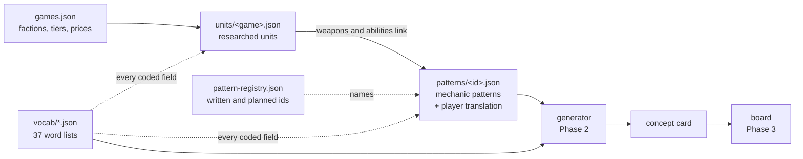

# Unit Forge, first step (section 7 of the brief): plan, fields, vocabularies and samples

**For:** Mustafa · **Status:** approved on 18 October 2026, decisions 1B 2A 3C 4B 5B 6C 7B 8B 9A (see [Decisions taken](#decisions-taken)) · **Covers:** section 7 of the brief (the plan and repository structure, the full list of fields and vocabularies, and the Terror Drone, Hammer Tank and Allied IFV with three patterns, fully filled in)

## TL;DR

- **What this is.** The plan for Unit Forge, every field and word list the research will use, and the three requested units and three mechanic patterns, filled in and cited. The big research run starts only after you approve this.
- **What to read.** This page, the [samples](samples.md) (about an hour in full; the three "Translation to a player-controlled unit" sections take about 15 minutes) and the core lists in the [vocabularies](vocabularies.md). The [field reference](fields.md) is there for the details.
- **How the data fits together.** Researched units link to *mechanic patterns*. Each pattern carries the heart of the tool: how it plays when one player *is* the unit, as the user, as the target and for teammates. The generator combines word-list terms and patterns into concept cards, and cards go on your board.
- **The three samples.**
  - **Terror Drone:** a cheap T1 drone that rides inside an enemy vehicle.
  - **Hammer Tank:** a T2 battle tank that can steal the gun of a vehicle that dies in its beam; it holds one stolen gun and can't swap it.
  - **Multigunner IFV:** a T1 car whose roof weapon depends on which soldier rides inside.
- **The three patterns.** *Infest a vehicle*, *leech the weapon of what you destroy* and *a weapon that changes with the passenger*. Each has 7 sourced RTS examples, 4-5 shooter examples and 7-10 variants the generator can roll.
- **How it was checked.** Separate fact-checking agents re-opened the cited sources and checked every sourced unit claim and every pattern example, and two review agents (one as a shooter designer, one checking completeness) read everything. Their fixes are applied, and a second independent round checked the fixes. Each record's review field still says "unchecked" on purpose; the check results are summarised in the pull request (the GitHub page where this change waits for your OK).
- **One finding worth knowing.** The Hammer Tank is *not* a starter tank: like every RA3 main battle tank it needs a tech step, so it is T2. RA3's T1 vehicles are harvesters, builder trucks, transports and light fighting units such as the Terror Drone and the IFV. All three samples also break rules we want for Shamble; for example, the IFV can stun infantry at T1. The data records such units as they are and lists each break, so we can choose which rules to keep.
- **Your input is needed on nine decisions** (at the end). The most important ones: how the tier limit on abilities works, who controls a multi-seat vehicle when you are alone in it, and what happens when a vehicle dies.

## Contents

1. [What is in this step](#1-what-is-in-this-step)
2. [The plan](#2-the-plan)
3. [Repository structure](#3-repository-structure)
4. [How the data fits together](#4-how-the-data-fits-together)
5. [Fields](#5-fields)
6. [Vocabularies](#6-vocabularies)
7. [The samples](#7-the-samples)
8. [How this draft was made and checked](#8-how-this-draft-was-made-and-checked)
9. [Risks](#9-risks)
10. [Decisions needed](#decisions-needed)
11. [For Mustafa](#for-mustafa)

## 1. What is in this step

| File | What it is |
|---|---|
| `docs/proposal.md` | This page. |
| `docs/samples.md` | The three units, three patterns and an example concept card, in readable form. |
| `docs/vocabularies.md` | All 37 word lists (299 terms) with their meaning and combination rules. |
| `docs/fields.md` | Every field of every record type. |
| `data/units/ra3.json` | The three source units. |
| `data/patterns/*.json` | The three patterns, one file each. |
| `data/pattern-registry.json` | Every pattern id agents may use: the three written patterns and 23 planned ones (see section 4). |
| `data/vocab/*.json` | The word lists, one file each (draft version 0.3.0). |
| `data/games.json` | The games registry, with Red Alert 3's tech tiers, price bands and speed reference. |
| `schemas/*.schema.json` | Draft JSON Schemas for every record type, including the concept card and the board (later phases). |
| `docs/examples/concept-card.example.json` | One hand-made concept card, to show what the generator will produce. |

The three reference pages (`samples.md`, `vocabularies.md` and `fields.md`) were generated from the JSON with a temporary script, so they match the data; this page is written by hand. The real tooling comes in the next step: the validator, the docs builder and a copy-check that flags any run of six or more words shared with a cited page, so automatic copyright checks run from then on. Everything validates against the schemas. No tooling, generator or app code is in the repository yet; that starts after your approval.

## 2. The plan

### 2.1 Phases and pull requests

| Step | What happens | Output | Pull requests |
|---|---|---|---|
| Now | **This proposal.** | Plan, fields, word lists, 3 units, 3 patterns, example card. | This one |
| 1 | **Foundations.** Turn the temporary checks used for this draft into real scripts: the validator, the docs builder and a copy-check. Set up CI (automatic checks that run on every change). Fill the games registry for the whole starting scope, and grow the pattern registry to about 50 pattern names so every research agent uses the same ones. | Repo tooling and CI; `data/games.json` complete. | 1 |
| 2 | **Calibration pilot.** Three agents fill in the same three RA3 units without seeing each other's work, plus three units from games whose tiers and prices work differently from RA3: StarCraft II (two resources), Company of Heroes (three resources and tier buildings) and Battlefield (no prices or tiers). Any field they agree on less than about 80% of the time gets a sharper rule or a merged term, plus tie-break rules (rules that settle which of two similar terms to use). Then the word lists are frozen as version 1.0. You see the changes from 0.3 to 1.0, and batch R1 starts only after you OK them. | Word lists 1.0, tie-break rules. | Part of step 1 |
| 3 | **Research run.** Six batches (below), each in its own pull request. Per batch: research agents, then a separate checker, then the validator. | Units and proposed patterns, with a short report per batch. | 6 |
| 4 | **Pattern consolidation.** Merge duplicate patterns, set the generator rules, write the coverage report and the top-30 list. | `docs/research/coverage.md`, `docs/research/top-30-patterns.md`. | 1 |
| 5 | **Generator.** A pure TypeScript module: seeded rolls (each roll has a seed, a short code that rebuilds it exactly), lock and reroll, spice, rules, balance hints, text templates and original names, with full tests. | `src/core/`. | 2-3 |
| 6 | **App.** Generator view, library, board, compare, duplicate and edit, remix, export and import, then polish (light and dark mode, keyboard) and deployment to GitHub Pages. | `src/app/`, a public link. | 4-6 |

How the steps map to the brief: this proposal is its first step (section 7); steps 1-4 are Phase 1, the research; step 5 is Phase 2, the generator; and step 6 is Phase 3, the app.

Every pull request stays small, runs the schema checks and tests in CI, and ends with a report in the brief's format: TL;DR first, "Decisions needed" and "For Mustafa" last.

### 2.2 The research run

**Batches**, one research agent per franchise inside each:

| Batch | Games |
|---|---|
| R1 | Red Alert 1, 2 (with Yuri's Revenge) and 3 (with Uprising) |
| R2 | C&C Tiberian Dawn, Tiberian Sun, Tiberium Wars (with Kane's Wrath), Renegade |
| R3 | C&C Generals (with Zero Hour), Tempest Rising, Iron Harvest |
| R4 | Company of Heroes 1-3, World in Conflict, Wargame, Broken Arrow |
| R5 | Supreme Commander, Planetary Annihilation, StarCraft II, Halo Wars 2, Dawn of War 1-2 |
| R6 | Battlefield (vehicle archetypes), PlanetSide 2, Foxhole, WARDOGS, Arc Raiders, MechWarrior/BattleTech |

**How a batch runs:**

1. **Before the agents start,** I check each game's registry entry (filled in step 1: factions, expansions, tech tiers, price bands, speed reference) and share the pattern registry, so every agent uses the same pattern ids.
2. **Each agent proposes candidate units for each game** that teach something: a distinct mechanic, an iconic counter or a memorable twist, about half again as many as the size you pick in decision 8. I trim the list to that size and remove repeats, then the agent fills the entries, using this step's three units as worked examples. New mechanics are added to the pattern registry and written up as *proposed* patterns, one file each.
3. **A separate checker** re-opens the sources for at least one unit in five per game (at least three), plus one new pattern in three (at least three). Batch R1 checked every new pattern; from R2 the checker samples them, because each pattern already gets its own skeptic when it is written (your decision of 22 October 2026). It focuses on tier, cost and abilities, and records which fields it checked and which were wrong. A batch with more than 15% wrong fields is redone.
4. **The validator** must pass: schemas, word lists, links between files and combination rules (any rule a real unit breaks must be recorded in its "atypical" list). A copy-check flags any run of six or more words shared with a cited page, and image links are rejected.
5. **The pull request report** lists coverage gained, units that break our rules, and places where no term fitted (the "vocabulary gaps" that feed the next word-list version).

**Games added beyond the starting scope** need a reason: the new mechanic they teach and the patterns that justify them. They are listed in the registry and in the final report. This draft already cites three such games (Titanfall, Halo and Mega Man), only as shooter examples in the patterns and as 'seen in' examples in a few word lists, with no researched units.

**Size target:** about 250 units and 80-100 patterns after merging. See decision 8.

**Coverage report:** games × classes, units per franchise, patterns per category, patterns by how many franchises use them, units without tiers or prices, rule breaks, and vocabulary gaps.

**Top-30 patterns for a player-controlled shooter:** ranked by a published formula: 2 × shooter fit (1-5) + team-play potential + (4 − build difficulty) + (4 − readability risk) + the number of franchises that use it (capped at 5). The three ratings count low = 1, medium = 2 and high = 3. Plain mechanics (sprint, self-heal, stat buffs) are excluded, and every entry gets a one-paragraph reason.

**Source access.** The Command & Conquer wiki blocks automatic page downloads but offers an official API (a data access point for programs), which this step's research used. It slows down heavy use, so the run spaces out its requests and keeps local copies of the pages it has read; those copies stay off GitHub. Other sources: StrategyWiki, CNCNZ, official pages and patch notes, and the established wiki for each series. Recent games with thin wikis (WARDOGS, Arc Raiders, Broken Arrow) may cite gameplay video at lower confidence.

### 2.3 The generator (Phase 2) at a glance

- **Inputs:** class, tier, faction flavour, optional role, spice (1 grounded to 5 wild), a seed, and any locked parts.
- **Roll order:** class, then the signature pattern (which sets parts it needs, such as passenger seats), then mobility, body, size, speed, armour, crew, weapons, extra abilities, matchups and text. Every step only offers terms that fit everything already chosen, so nonsense such as tracks on an aircraft can't be rolled.
- **Seeds:** each field gets its own dice, worked out from the seed and the field's name, so locking or rerolling one part never reshuffles the dice of the others. A seed plus the same data version always rebuilds the same card.
- **Spice:** each term has a rarity. Spice 1 offers only common parts; uncommon parts appear from spice 2 and rare cross-overs from spice 4. A faction flavour makes its favoured parts three times as likely and one step more common for that faction (rare counts as uncommon, uncommon as common), so a grounded Soviet card can roll tesla weapons and an Allied card at spice 2 can roll prism. It holds back its avoided parts until spice 3.
- **Rules from the brief:**
  - aircraft don't get tracks (combination rules on every term);
  - tiers cap abilities (a key budget per tier, see decision 1). The universal keys every unit shares never count: E interact (enter or leave a seat, pick up), hold F shake off anything attached to you, hold X bail out of a vehicle, 1-3 switch seat, middle mouse ping, and G for a transport's driver to evict passengers;
  - every strength is paired with a weakness;
  - every card has at least one counter that some valid card can actually satisfy.
  A card that breaks a rule is rerolled. Hand-edited and remixed cards show the break as a warning flag instead.
- **Remix:** you pick 2-3 source units or patterns; their parts become locked or favoured inputs and the generator fills the rest by the same rules. The card records them in "remix of".
- **Balance hints:** a cost band derived from the parts, a power score and a complexity score, the number of keys, and warning flags.
- **Text:** the working name, pitch and "how it plays" are built from templates, using the patterns' player translations and faction word banks. No AI is used in version 1. Names are checked against every real unit name in the database.
- **Tests:** the same seed reproduces exactly; 10,000 random rolls produce zero invalid cards (checked by a validator separate from the generator); every class, tier, flavour and role combination either yields a valid card or is greyed out in the app.

### 2.4 The app (Phase 3) at a glance

A static TypeScript site built with Vite, with no backend. The data ships as the JSON files in the repository. Rolls run in the browser and are instant. The library lists the source units (by game and faction) and the patterns, and filters them by class, role, tier and mechanic. The board is saved in the browser with a version number and migrated automatically when the format changes. It can be exported and imported as JSON, and exported as Markdown. The look is a design dossier: a corkboard of index cards that is readable, keyboard-friendly and has light and dark modes. It is deployed to GitHub Pages, so you just open a link.

## 3. Repository structure

```
README.md
docs/
  proposal.md                  this page
  samples.md                   the 3 units, 3 patterns and example card (generated)
  vocabularies.md              every word list (generated)
  fields.md                    every field (generated)
  examples/
    concept-card.example.json
  research/                    later: coverage report, top-30, checker reports, vocabulary gaps
data/
  games.json                   games registry
  pattern-registry.json        every pattern id, written or planned
  vocab/<list>.json            37 word lists
  units/<game>.json            source units, one file per game
  patterns/<pattern-id>.json   one mechanic pattern per file
schemas/
  common, vocabulary, game, source-unit, pattern, pattern-registry, concept-card, board (.schema.json)

Added in later steps:
scripts/                       validate, build-docs, coverage, sample-for-check, copy-check
research/<batch>/              agent notes, notes on poor fits, checker logs (page cache is git-ignored);
                               new patterns go straight to data/patterns/ with status "proposed"
data/manifest.json             content hash of the data, stored on every card
src/core/                      the generator: pure TypeScript, no browser code
src/app/                       the web app
tests/
.github/workflows/             CI (validate, test, docs in sync) and GitHub Pages
index.html, package.json, tsconfig.json, vite.config.ts
```

## 4. How the data fits together



- A **source unit** is one real unit, coded with word-list terms. Its weapons and abilities link to patterns. Its strengths, weaknesses and counters are **typed links** such as `class:aircraft` or `size:<=small` (short tags that mean "is an aircraft" or "is small or smaller"), so the generator can reason about matchups instead of only reading prose.
- A **pattern** is a reusable mechanic, abstracted from one or more units. It records what it does and its counterplay, sourced examples from other games, the player translation, team-play potential, build difficulty, balance and readability risks, variants, and rules for the generator.
- The **pattern registry** lists every pattern id agents may use: the three written patterns and 23 planned ones, which have a name and a one-line summary but no file yet. It already holds all nine example patterns the brief names. Agents must use these ids rather than invent names. A link to a planned pattern gives a warning; an id that is not in the registry is an error. The samples already link to some planned ones, such as *switch weapon mode*, *disable a machine*, *drain health* and *hijack a vehicle*.
- A **concept card** is a generated unit. It stores its seed and every part id, so it can be rebuilt exactly.

## 5. Fields

The full list, with types and meanings, is in [fields.md](fields.md). In short:

- **Source unit:**
  - **Identity:** id, game, faction, name, lineage (the same design across games).
  - **Classification:** class, nature (organic, crewed machine, uncrewed machine), availability (open, limited, unique), roles, tier and cost band (with the building or research that unlocks it in the source game, and its price).
  - **Movement and body:** mobility (base, handling, traits, speed), body (plan, size, count).
  - **Combat:** armour (class plus up to three models), armament (each weapon's slot, seat, family, damage, mount, delivery, range, targets and traits), crew (model, seats, solo fallback, passengers), abilities (kind, cooldown, where it comes from), modes for transforming units, resources, what happens on death.
  - **Matchups:** strengths, weaknesses, counters, countered-by and combos.
  - **Notes and checking:** why it's memorable, how it plays as a player, 1-3 sources (with the fields each one backs), confidence, specific uncertain points, notes where no term fitted, the combination rules it breaks ("atypical"), and the checker's review.
- **Pattern:**
  - **Identity:** id, status (proposed, accepted, merged, rejected), name, aliases, in-game names, category.
  - **Substance:** summary, counterplay, source units, other sourced examples, shooter analogues.
  - **Translation:** user, target, teammates, controls, readability cues, and what changes from the RTS.
  - **Ratings and generator data:** team play, build difficulty, balance and readability risks, variants, generator rules, related patterns, open design questions, shooter-fit score, confidence and review.
- **Concept card:**
  - **Reproduction:** seed, spice, inputs, locks.
  - **Parts:** class, tier, flavour, nature, availability, roles, mobility, body, armament (primary, secondary and conditional weapons), armour, crew, signature ability, extra abilities, second form, resource, on death.
  - **Matchups:** strengths paired with weaknesses, counters, countered-by, counterplay.
  - **Text:** working name, pitch, signature name and effect, team-play hook, how it plays (user, target, teammates, controls, tells).
  - **Inspiration and balance:** inspiration, balance hints.
- **Board:** a version number (so saved boards can be migrated) and the saved cards: each card plus column, position, notes, tags, stars, origin, parent, and the fields you edited by hand (a reroll never touches those).
- **Word list:** id, label, description and version, and per term its meaning, rarity and combination rules.
- **Pattern registry:** per pattern id its name, category, a one-line summary and whether the brief names it.

Fields marked *proposal* (handling, weapon mount and seat, flavour affinity and "as a player"), and crew and on-death wherever their basis says "proposal", are our design suggestions for a player version. They are kept apart from sourced facts, and the checker skips them.

## 6. Vocabularies

All 37 lists are in [vocabularies.md](vocabularies.md). The ten the brief asks for:

| List | Terms | Examples |
|---|---|---|
| Classes | 7 | Infantry, tank / ground vehicle, walker / mech, hovercraft, aircraft, drone / support; naval (research only) |
| Tier bands | 3 | T1, T2, T3, each with a key budget |
| Faction flavours | 3 | Soviets, Allies, Empire, each with themes, favoured parts and a naming style |
| Roles | 16 | Assault, anti-armour, anti-air, siege, marksman, scout, support, transport, infiltrator, disabler, raider, area denial, buffer, engineer, logistics... |
| Mobility types | 12 | Foot, jetpack, wheels, tracks, two legs, many legs, hover, hovering flight, jet, airship... |
| Body plans | 18 | Humanoid, power suit, creature, hull with turret, fixed-gun hull, open mount, troop carrier, launcher rack, mechs, aircraft frames... |
| Weapon families | 32 | From small arms and cannons to tesla, prism, cryo, sonic, nanites, psionic, repair tools and "adaptive" (taken from a passenger or a kill); torpedoes and "unarmed" are research only |
| Damage types | 13 | Kinetic, armour-piercing, explosive, fire, electric, energy, cryo, sonic, toxic, EMP, melee, psionic, repair |
| Armour classes | 5 | Unarmoured, light, medium, heavy, super-heavy |
| Crew models | 5 | Solo, driver + gunner, driver + gunner + commander, squad, remote operator (passenger seats are counted separately) |

The 27 supporting lists make the core ones usable: aim / mount, weapon delivery, range bands, weapon traits, target types, handling, mobility traits, speed bands, sizes, armour models (most with examples from the reference games), nature, seat roles, solo fallback, ability kinds, ability sources, cooldown bands, resources, on death, availability, cost bands, pattern categories, team-play hooks, balance flags, rarity, confidence levels, ratings and source kinds.

Each term can carry **combination rules**: which classes may use it, what it combines with, what it excludes, what it needs, and the lowest tier. These stop the generator rolling nonsense. Real units that break them are recorded as they are, and each break goes in the unit's "atypical" list; the validator fails if a break is missing from it. For example, the IFV stuns infantry at T1 when it carries an attack dog or a war bear, although our stun trait starts at T2.

**Faction flavours, in RA3's spirit:**

- **Soviets:** heavy, brute force, electric weapons, magnetism, salvage, big walkers and airships.
- **Allies:** high-tech and precise; freezing and prism weapons, lock-ons, time tricks, shields and seats that work together.
- **Empire:** agile and transforming; blades, nano-tech, psionics and kamikaze drones.

## 7. The samples

All in [samples.md](samples.md).

| Sample | One line | What the research added |
|---|---|---|
| **Terror Drone** (Soviets, T1 drone) | A tiny robot that rides inside an enemy vehicle; you can't shoot it there, so the enemy has to cure the host. | Five sourced threats that beat it (aircraft, machine guns, electric weapons, repair tools, snipers), escaping a host it destroyed, and a stasis ray that pins a vehicle but leaves its guns working. |
| **Hammer Tank** (Soviets, T2 vehicle) | A battle tank that steals the gun of a vehicle that dies in its leech beam. | It is T2, like every RA3 battle tank. The steal works whoever lands the kill (a built-in team combo), it holds one stolen gun and can't swap it, the beam also drains ships, and leeching roots the tank (the shooter version slows it heavily and locks its turret instead). |
| **Multigunner IFV** (Allies, T1 vehicle) | A fast car whose roof weapon is set by the soldier riding in it. | 18 passenger results across all three factions (dog and bear split), plus its turretless hull, the passenger dying with the car, and the dog and bear stun at T1. |
| **Infest a vehicle** (pattern) | Latch onto or into a vehicle and work on it until removed. | Shooter fit 5/5. Ten variants. Titanfall's rodeo, Halo boarding and Arc Raiders' Tick show the victim's side; the translation always gives the victim an escape (hold F to shake it off). |
| **Leech the weapon of what you destroy** (pattern) | Turn enemy losses into your own weapons. | Shooter fit 4/5. Seven variants, from tether-and-copy and upgrade ladders to a willing teammate donor; the key risks are snowballing and teammates farming each other. |
| **A weapon that changes with the passenger** (pattern) | A vehicle whose gun is whoever rides in it. | Shooter fit 5/5. Nine variants, among them fire ports, a tool seat and human ammunition; RA3's 18 results collapse into 4-6 readable loadout groups. |
| **Example card: Rime Burr** (hand-made) | An Allied T1 hover-drone that latches onto enemy vehicles; while it rides, the host shows on the drone team's minimap, and every hit that team lands builds frost until the hull turns brittle. | Shows a pattern moved to a new faction and mobility, with one original twist (a frost meter the team fills), within the T1 key budget. |

No variant of the infest or leech pattern lets you steal a whole vehicle; that is left to the planned *hijack a vehicle* pattern. Both patterns still list hijacker units among their examples, marked "for contrast"; they move to the hijack pattern when it is written.

## 8. How this draft was made and checked

1. **Research.** Eight agents researched in parallel:
   - one per unit and one per pattern, citing every claim with sources and a confidence level;
   - two more checked the armour-model and crew-seat word lists against the reference games.
2. **Critique.** Four independent review agents, each given one expert role, attacked the first draft of the fields and word lists:
   - a generator engineer;
   - a top-down shooter designer;
   - a research data-quality lead;
   - a stress test that encoded 16 more real units from across the reference games, two of them from Red Alert 3 itself (StarCraft II Siege Tank, RA3 Mecha Tengu and Kirov, Mammoth Mk II, Overlord, Panther, a Foxhole tank, Supreme Commander's ACU, Sunderer, Magrider, Warthog, an Arc Raiders raider, Atlas, Dreadnought, a mobile SAM, an Iron Harvest hero mech).

   Their findings led to version 0.3. Its main changes:
   - aim is split into mount and delivery, and every weapon gets a range;
   - handling, nature and what happens on death are new fields;
   - the tier limit counts buttons rather than abilities;
   - seats own weapons, passengers are counted separately, and transforming units record a second form;
   - one pattern per file, with a status and merging;
   - games without tiers or prices are allowed;
   - each source lists the fields it backs up, and tie-break rules settle terms that are easy to confuse.
3. **Validation.** A temporary validator (the real one comes in step 1) checks the data, and it passes:
   - schemas and every term;
   - every link between files. Links to planned patterns, and to units not researched yet (such as the IFV's passenger soldiers), give warnings; a pattern id that is not in the registry would be an error;
   - every combination rule. A real unit may break a rule, but it must record the break in its "atypical" list or the check fails. The samples record six: the IFV's tier-1 stun (on two entries, dog and bear), two weapon-family breaks on the IFV (a laser that does gun damage, and a psionic blast that hits buildings), the Hammer's leech beam working on ships, and the Terror Drone's claws infesting ships;
   - the example card fits the T1 key budget;
   - 18 deliberately broken copies of the data are each caught, and a 19th test confirms that a link to a planned pattern only warns. Among them: tracks on an aircraft, too many keys, a missing cooldown, an unpaired strength, a real unit in a card's matchups, a working name copied from a real unit, a pattern id missing from the registry, and a rule break missing from "atypical".
4. **Verification.** Separate fact-checking agents re-opened the cited sources and checked every sourced claim in the three units and, in the three patterns, every example, the summaries, the counterplay and the games each variant comes from. They also looked for wording copied from the sources and found none. Two review agents, one as a shooter designer and one checking completeness, then read everything. Their fixes are applied in this draft, and a second round of three independent agents checked the fixed units, patterns, card and this page. The review field in each record stays "unchecked" on purpose, and the three patterns stay "proposed" until the merge pass in step 4 accepts them; the check results are summarised in the pull request.

## 9. Risks

- **The word lists are big** (37 lists, 299 terms). Only the ten core lists need your eyes; the supporting lists are mostly scales and plumbing.
- **Sources can be thin or slow.** The C&C wiki slows down heavy use, and some recent games have little written about them. Mitigations: local copies of pages, spaced-out requests, video at low confidence, and recording "no tier or price" rather than inventing one.
- **Live games change.** Each game records the version or date researched.
- **Generator tuning** (rarity weights now, cost points with the generator) can only be judged once there are about 100 units; the weights in the draft are starting points.
- **Copyright.** From step 1, a copy-check flags any run of six or more words shared with a cited page. Real names never reach generated cards, and no images are used.

## Decisions needed

<a id="decisions-taken"></a>
**Decisions taken (Mustafa, 18 October 2026): 1B 2A 3C 4B 5B 6C 7B 8B 9A.** All follow the recommendations; decision 6 is C because Shamble Frontlines will have jets and airships. What changes in step 1 as a result: combination rules become hard bans only for physical nonsense, with a rarity per class for the rest (4B), and units get a sensors field and two air layers, low and high (6C). The other choices match what the draft already uses.

Each one stands on its own. The options as they were put:

1. **What counts toward a tier's ability limit?** The brief says tiers cap abilities.
   - **A.** Count abilities only: active abilities up to the tier number (T1 one, T2 two, T3 three), plus one passive.
   - **B.** Count buttons: everything on a key except primary fire and movement (secondary weapon, abilities, toggles, deploys, dash or leap). T1 gets 2 keys, T2 3 and T3 4, plus at most one passive, and no more than 3 keys per seat.

   Either way, the universal keys that every unit shares never count: E interact (enter or leave a seat, pick up), hold F shake off anything attached to you, hold X bail out of a vehicle, 1-3 switch seat, middle mouse ping, and G for a transport's driver to evict passengers.

   **Recommendation: B.** It measures what the player actually has to juggle, and it stops a "simple" T1 from hiding five buttons in toggles and movement tricks. The draft uses B, with this layout: WASD to move, the mouse to aim, left mouse for primary fire, right mouse for the secondary weapon, Q for the signature ability, R for a second ability and Space for key-bound movement. A signature that is the unit's primary weapon can sit on left mouse instead, like the infester's pounce.
2. **Who controls a multi-seat vehicle when you are alone in it?**
   - **A.** The buyer drives and fires the main weapon; extra seats add a second gun, spotting or passenger effects (Battlefield and PlanetSide style).
   - **B.** The main gun needs a second player (Foxhole style).
   - **C.** Alone, you switch seats: drive or shoot, not both.

   **Recommendation: A** as the default, with B and C only as rare high-spice variants. In a buy-and-become game nobody should need a friend to use what they paid for. The draft uses A. The word lists also keep a fourth option, an auto-gunner (empty gun seats fire on their own at reduced accuracy), as an uncommon variant.
3. **What happens when your unit dies?**
   - **A.** Always back to the buy screen.
   - **B.** Vehicle crews always bail out as weak infantry.
   - **C.** Decided per unit: respawn, bail out, wreck (repairable or salvageable), death blast or pilot eject.

   **Recommendation: C**, with bail-out as the default for crewed vehicles and respawn for infantry and drones. The draft uses C.
4. **How strict should combination rules be at high spice?**
   - **A.** Absolute: a flamethrower helicopter never appears.
   - **B.** Hard bans only for physical nonsense (tracks on aircraft); other cross-class parts just become rare and appear at high spice.

   **Recommendation: B.** It is what makes spice 5 produce real "rare cross-overs". The draft currently uses A. B means one change to the word lists before the research run: instead of a yes/no list of classes, each part gets a rarity per class.
5. **Hard crowd control (stuns and freezes that stop the victim acting).**
   - **A.** Allowed anywhere.
   - **B.** Stuns only from T2, kept short and on a medium or longer cooldown, and every lockdown card must state the victim's escape.
   - **C.** No stuns at all; only roots (can't move), silences (can't shoot or use abilities) and slows.

   **Recommendation: B.** The infest and freeze fantasies need some lockdown, but the player on the receiving end must always have something to do. The draft uses B: hold F, a universal key, shakes off any latch or tether, and the generator will enforce the cooldown rule in Phase 2. Real units that break it, such as the IFV's T1 stun, are recorded as rule breaks.
6. **Vision and air.** Does Shamble Frontlines hide enemies outside line of sight, and is there more than one air layer?
   - **A.** Line-of-sight fog of war, one air layer.
   - **B.** Everything on screen is visible, one air layer.
   - **C.** Fog of war and two air layers (low: helicopters, drones, jetpacks; high: jets and airships, hit only by anti-air).

   **Recommendation: A** if Shamble will have no jets or airships (we then drop those two from the word lists, which include them now), otherwise **C**. With fog, units get a small "sensors" field (sight range, radar, stealth, detection) before the research run; with B, spotting and scouting terms shrink.
7. **Heroes and squads.**
   - **A.** "Hero" stays a role, and every player is always one body.
   - **B.** Hero becomes an availability flag (open, limited, one per team) that any role can have, and "squad" (one player plus a few AI followers, or a pack of tiny drones) is a rare crew model from spice 4.

   **Recommendation: B.** A commando card still says what it does, team caps become explicit, and squad-based sources (Company of Heroes, Dawn of War) translate honestly. The draft uses B.
8. **How big should the research run be?** The starting scope has 28 games and series.
   - **A.** Lean: about 5 units per game (about 150 units) and 60 patterns, with the six batches merged into 3 pull requests; the fastest route to the generator.
   - **B.** Standard: about 9 units per game (about 250 units) and 80-100 patterns, 6 pull requests.
   - **C.** Deep: about 15 units per game (about 400 units) and over 120 patterns, 8 or more pull requests.

   **Recommendation: B.** It covers every game in the brief with enough examples per pattern, without a long wait for the generator.
9. **Repository name.**
   - **A.** Keep `MoesTools-Brainstormer` and call the product Unit Forge inside it.
   - **B.** Rename the repository to `unit-forge` now. GitHub redirects old links, and the Pages link would change.

   **Recommendation: A.** No work and nothing breaks; renaming stays cheap until the app is published.

**Defaults I picked (tell me if any are wrong):**

- **Classes:**
  - "Tank" is widened to "tank / ground vehicle" so IFVs and buggies fit.
  - Ships are recorded for research only and never generated.
  - "Drone / support" means small uncrewed machines; support is a role, so a repair truck is a vehicle with the support role.
- **Research coding:**
  - Tiers come from tech gating only.
  - Where a stat table gives a unit's price or speed, the exact number is stored next to its band only so the band can be recomputed. Notes and summaries stay relative ("about twice the cannon's range"), and the generator and the app never show or use the number. This bends the brief's "exact stats only as relative bands" rule; say if you'd rather we store bands only.
  - Logistics units (harvesters, supply trucks) are recorded sparingly, under a logistics role.
  - Loadout options and in-match upgrades are recorded during research; whether the generator rolls them is decided later.
  - Battlefield, MechWarrior/BattleTech and Wargame are researched as series (archetypes); Company of Heroes 1-3 title by title.
  - Games cited beyond the starting scope (Titanfall, Halo, Mega Man) are reference examples only: they appear as shooter examples in the patterns and as 'seen in' examples in a few word lists, and get no researched units.
- **Player-version proposals:**
  - The passenger aims a passenger-set weapon from a small roof turret, scaled to the car's tier; if the car dies, both players are thrown out hurt.
  - Stolen weapons are scaled to the thief's tier, and a new claim replaces the old one; leeching slows the tank heavily and locks its turret instead of rooting it.
  - Infestation always comes with a self-cleanse for the victim (hold F). If anything but the infester's own damage destroys the host, the infester is thrown clear hurt, not killed.
- **Other:**
  - No AI-written text in version 1 (the brief lists it as later).
  - The app uses Preact, a small library for building the screens; the brief names only TypeScript and Vite.

## For Mustafa

1. Read the TL;DR and the [decisions](#decisions-needed), and reply with your choices. A list like "1B 2A 3C..." is enough.
2. Skim [samples.md](samples.md), especially the three "translation to a player-controlled unit" sections. Do they feel like Shamble Frontlines?
3. Skim the core lists in [vocabularies.md](vocabularies.md) (classes, roles, flavours, mobility, bodies, weapon families) for anything wrong for your game.
4. Reply with your choices and "approved" (as a comment on the pull request, or in our chat), or tell me what to change. A reply is enough: the pull request was opened from the repository owner's account, and GitHub doesn't let a pull request's author press Approve. Nothing else is needed from you: no accounts, keys or installs.
